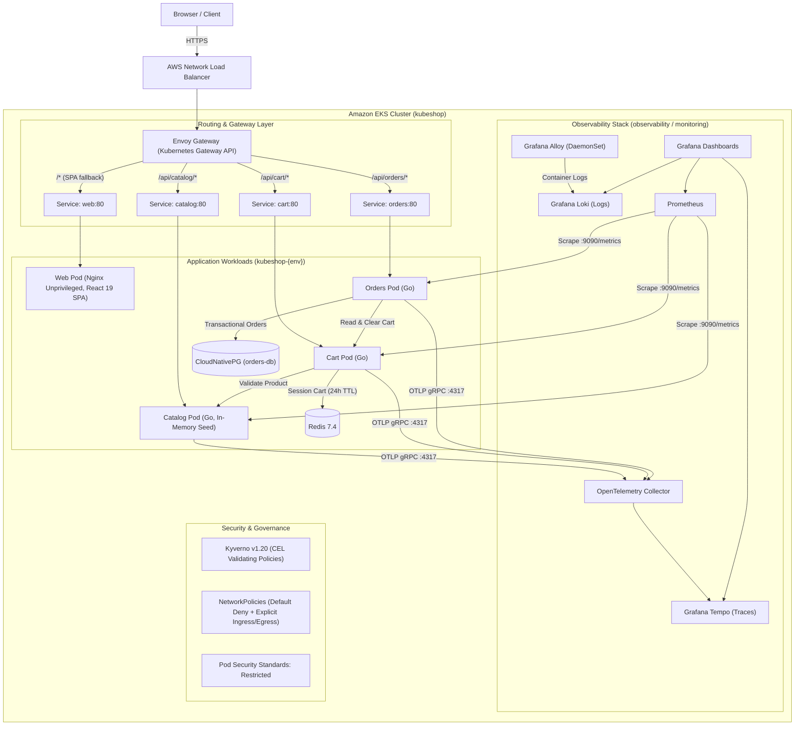
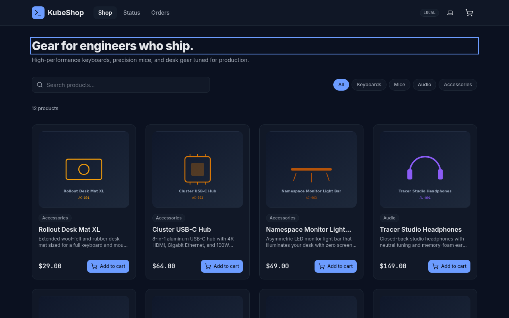
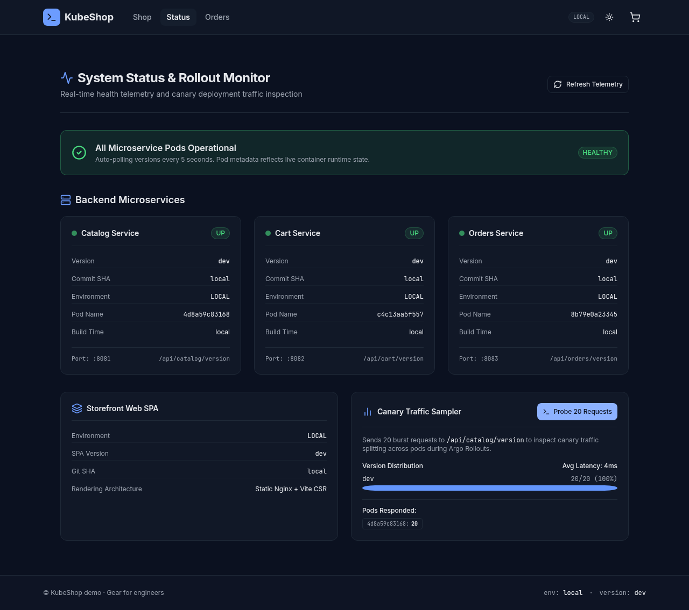

# KubeShop

> **Gear for engineers** — A production-grade, cloud-native microservices e-commerce platform and platform engineering showcase.

[](https://github.com/omar-riadd/KubeShop/actions/workflows/ci-services.yml)
[](https://github.com/omar-riadd/KubeShop/actions/workflows/ci-web.yml)
[](https://github.com/omar-riadd/KubeShop/actions/workflows/security.yml)
[](https://github.com/omar-riadd/KubeShop/actions/workflows/helm-gitops.yml)
[](https://github.com/omar-riadd/KubeShop/actions/workflows/terraform.yml)

GitHub Repository: [`https://github.com/omar-riadd/KubeShop.git`](https://github.com/omar-riadd/KubeShop.git)

---

## 1. Architecture Overview

KubeShop is built as a cloud-native monorepo demonstrating end-to-end DevOps and platform engineering practices: IaC (Terraform EKS), GitOps (Argo CD & Argo Rollouts), Progressive Delivery (Canary & Blue/Green), Observability with 28-day SLOs (Prometheus, Loki, Tempo, Alloy, OpenTelemetry, Grafana), Policy-as-Code (Kyverno v1.20 CEL), and hardened container security.



---

## 2. Core Components

### Microservices (`services/`)
- **`catalog`**: High-performance Go service loading 12 engineering gear products into memory at startup. Stateless, filtered search, pagination, category listing.
- **`cart`**: Go service managing anonymous customer sessions via `X-Session-ID` in Redis hashes (24h TTL). Performs snapshotting from `catalog` with exponential backoff retry.
- **`orders`**: Go service executing order placement within an ACID transaction on CloudNativePG (PostgreSQL 17), with idempotency key replay, batch order-item loading (`WHERE order_id = ANY($1)`), empty cart validation, order status lifecycle management (`PATCH /api/orders/{id}/status`), per-session token-bucket rate limiting (`rps=2, burst=5`), and automatic cart clearing.
- **`internal/platform`**: Shared package providing structured JSON logging (`slog`), OpenTelemetry tracing & propagation, Prometheus RED metrics, graceful shutdown with gateway drain delay, request body limits (16 KiB), fault injection (`FAULT_ERROR_RATE`, `FAULT_LATENCY_MS`), exponential backoff retries with jitter (`WithRetry`), and session rate limiting (`SessionRateLimiter`).

### Frontend SPA (`web/`)
- **React 19 + TypeScript + Vite**: Responsive desk gear storefront with Tailwind CSS v4 design tokens, TanStack Query v5, route-level `React.lazy` + `Suspense` code splitting (32.58 kB entry chunk), zero WCAG 2.1 AA violations (verified with Axe), and zero-FOUC theme switching (light/dark/system).
- **Flagship E-Commerce UX**:
  - **Instant `Cmd+K` Command Palette**: Global quick search (`Cmd+K`, `Ctrl+K`, `/`) with category pills, live query filtering, and keyboard navigation (`↑`/`↓`/`Enter`).
  - **Slide-Out Mini-Cart Drawer**: Slide-over drawer with real-time dynamic Free Priority SRE Dispatch progress bar ($75 threshold), in-drawer quantity management, and direct checkout CTA.
  - **Floating Sticky Quick-Buy**: Context-aware floating bar on product pages with instant Cart Drawer integration.
  - **Category-Tailored Unboxing ("What's in the Box")**: Technical packaging and accessory breakdown for each hardware gear category.
  - **Side-by-Side Spec Comparison**: Apple Store-style modal comparison matrix evaluating form-factor, switches, connectivity, latency, and weight.
  - **Frequently Bought Together Bundles**: Recommended gear bundles with automatic 10% bundle savings.
- **Platform Status Dashboard (`/status`)**: Live canary rollout observer measuring service health, response latency, active pod names, and real-time version traffic distributions.
- **Hardened Nginx**: Runs as unprivileged user `101`, `readOnlyRootFilesystem: true`, dynamic runtime configuration via `/tmp/runtime-config.json`, DRY modular security headers (`include /etc/nginx/security_headers.conf`), and strict Content Security Policy (`script-src 'self'`).
- **Comprehensive Test Harness**: 53 Vitest unit & component tests across 15 test suites and 15 Playwright E2E & WCAG 2.1 AA accessibility suites.

### Infrastructure as Code (`infra/terraform/`)
- **`bootstrap/`**: Versioned, KMS-encrypted S3 remote state bucket with native S3 locking (`use_lockfile = true`, Terraform >= 1.11; no DynamoDB table needed).
- **`modules/`**: 6 reusable internal modules:
  - `network`: 3-AZ VPC, public + private subnets, single NAT Gateway, EKS ELB/NLB discovery tags.
  - `eks`: Amazon EKS 1.35, KMS envelope encryption, `API` Access Entries, IRSA OIDC, spot & on-demand node groups.
  - `iam-irsa`: Least-privilege IRSA roles for AWS Load Balancer Controller, ExternalDNS, cert-manager, External Secrets Operator, and EBS CSI.
  - `secrets`: KMS-encrypted AWS Secrets Manager entries (`redis`, `slack-webhook`, `grafana-admin`).
  - `github-oidc`: GitHub Actions OIDC provider + read-only plan role and least-privilege protected apply IAM role.
  - `budget`: Monthly AWS Budgets alerts at 50%, 80%, and 100% thresholds.
- **`envs/main/`**: Wires all modules and bootstraps AWS Load Balancer Controller, Argo CD (with progressive syncs and private repo credentials secret), and root GitOps Application.

### GitOps & Progressive Delivery (`deploy/`, `gitops/`)
- **Shared Helm Chart (`deploy/charts/app`)**: Single chart rendering all 4 workloads (`catalog`, `cart`, `orders`, `web`) with `values.schema.json` enforcement, Argo Rollouts (canary for APIs, blueGreen for web), HTTPRoutes, ServiceMonitors, and NetworkPolicies.
- **Environment Baseline Chart (`deploy/charts/env-baseline`)**: Per-environment namespace quotas, default-deny NetworkPolicies, Redis StatefulSet with conditional PVC persistence (`gp3`, RDB `--save 60 1`) and PodDisruptionBudget, CloudNativePG cluster, and synthetic traffic generator (`k6`).
- **Argo CD GitOps**:
  - `gitops/bootstrap/`: Root bootstrap Application.
  - `gitops/platform/`: `RollingSync` ApplicationSet deploying 14 platform addons in progressive sync waves (cert-manager, external-secrets, kyverno, argo-rollouts, cloudnative-pg, keda, kube-prometheus-stack, envoy-gateway, external-dns, loki, tempo, alloy, otel-collector, opencost) + Wave 2 manifests.
  - `gitops/apps/`: Matrix ApplicationSets for `dev`, `staging`, and `prod`.

### Observability & SLOs
- **28-Day SLOs**:
  - `catalog` & `cart`: 99.5% availability (non-5xx excluding `/version`), catalog latency <300ms (95%).
  - `orders`: 99.5% availability on `POST /api/orders`, orders latency <800ms (95%).
- **Multi-Burn-Rate Alerts**: 14.4x fast burn (critical) and 6x slow burn (warning) routed to Slack via Alertmanager.
- **5 Grafana Dashboards as Code**: Service RED, SLO Overview, Argo Rollouts Canary Comparison, Kubernetes Capacity & Autoscaling, FinOps (OpenCost).

### Security & Governance
- **Kyverno v1.20 CEL Policies**: 7 policies enforcing Cosign keyless signatures, CycloneDX SBOM attestations, resource limits, immutable tags, approved registries, non-root/read-only rootfs/capabilities drop, and standard labels. Verified via `kyverno test` suite (10/10 passing).
- **Supply Chain Security**: Cosign keyless signing via GitHub Actions OIDC, CycloneDX SBOMs, SLSA provenance, Trivy container and IaC misconfiguration scanning.

---

## 3. Repository Structure

```
kubeshop/
├── .agent/STATE.md                      # Persistent AI agent session state & decisions
├── .github/workflows/                   # CI/CD pipelines (Go services, Web, Security, Helm/GitOps, Terraform, Promotion)
├── api/
│   ├── openapi.yaml                     # OpenAPI 3.1 single source of truth for all HTTP APIs
│   └── redocly.yaml                     # OpenAPI linter configuration
├── deploy/
│   ├── charts/app/                      # Shared workload Helm chart (Rollouts, Routes, NetworkPolicies)
│   ├── charts/env-baseline/             # Namespace baseline (Quotas, Redis, CNPG, k6 traffic)
│   └── compose/gateway.nginx.conf       # Local Nginx reverse proxy standing in for Envoy Gateway
├── docs/
│   ├── adr/                             # 8 Architecture Decision Records (ADRs 0001-0008)
│   ├── progress/                        # Phase-by-phase completion summaries (Phases 0-10)
│   ├── runbooks/                        # Operational runbooks (repo-setup, bootstrap, promotion, rollback, incident-response, teardown)
│   ├── ui/                              # UI design system & accessibility notes
│   ├── architecture.md                  # Deep-dive diagrams (runtime, CI/CD, GitOps, telemetry, security)
│   ├── cost.md                          # FinOps BoM, OpenCost attribution & budget alerts
│   ├── demo-script.md                   # 5-minute end-to-end live walkthrough script
│   ├── incident-demo.md                 # Canary abort, incident drill-down & blameless postmortem template
│   ├── CONTRACT-CHANGES.md              # Shared contract change protocol log
│   └── PLACEHOLDERS.md                  # Safe environment placeholder registry
├── gitops/
│   ├── bootstrap/                       # Argo CD root Application
│   ├── platform/                        # Platform addon values and Wave 2 cluster manifests
│   └── apps/                            # AppProjects, matrix ApplicationSets, and per-env values
├── infra/terraform/
│   ├── bootstrap/                       # Remote S3 state bucket + KMS key
│   ├── modules/                         # 6 AWS modules (network, eks, iam-irsa, secrets, github-oidc, budget)
│   └── envs/main/                       # Main cluster stack + Helm bootstrap
├── scripts/
│   └── bootstrap-placeholders.sh        # Automated placeholder substitution (--dry-run, --check)
├── services/                            # Go microservices monorepo (catalog, cart, orders, platform)
├── tests/load/                          # k6 load testing scripts (smoke, load, stress)
├── web/                                 # React 19 storefront SPA (lazy-loaded routes) + Playwright E2E suite
├── .env.bootstrap.example               # Template for automated placeholder bootstrap (`make bootstrap`)
├── docker-compose.yml                   # Local multi-service development stack
├── Makefile                             # Common developer targets (dev, test, bootstrap, cluster-down)
├── PROGRESS.md                          # Milestone-by-milestone implementation checklist
└── renovate.json                        # Renovate automated dependency configuration
```

---

## 4. Local Quickstart

### Prerequisites
- Docker & Docker Compose
- Go ≥ 1.24
- Node.js ≥ 22 & pnpm (via corepack)
- Helm ≥ 3.17 & Terraform ≥ 1.11

### Run Locally

```bash
# 1. Start the backend services (Redis, Postgres, Catalog :8081, Cart :8082, Orders :8083)
make dev-backend

# 2. Start the full stack with Web SPA and local Gateway (:8080)
make up
# Access the storefront at http://localhost:8080

# 3. Stop all local containers and volumes
make down
```

> **Note:** When running `orders` outside Docker Compose, `DATABASE_URL` defaults to `sslmode=require` and refuses unencrypted connections; pass an explicit `DATABASE_URL` (as `docker-compose.yml` does) if your local PostgreSQL instance does not have TLS enabled.

### Run Tests & Linting

```bash
# Backend unit, integration, and OpenAPI contract tests
make test

# k6 end-to-end smoke test (against running 'make up' stack)
make load-test

# Frontend unit & component tests (Vitest + RTL + MSW; 36/36 passing)
pnpm --dir web test --run

# Frontend production build & typecheck
pnpm --dir web build

# Helm charts linting
helm lint deploy/charts/app
helm lint deploy/charts/env-baseline

# Kyverno CEL policy tests (10/10)
kyverno test gitops/platform/kyverno/tests

# Terraform validation and formatting
terraform fmt -check -recursive infra/terraform
terraform -chdir=infra/terraform/bootstrap validate
terraform -chdir=infra/terraform/envs/main validate
```

---

## 5. Environments & Promotion

| Environment | Namespace | URL | Deployment Method |
|---|---|---|---|
| **Local** | N/A | `http://localhost:8080` | Docker Compose (`make up`) |
| **Dev** | `kubeshop-dev` | `https://dev.<BASE_DOMAIN>` | Auto-deployed from `main` via GitHub App Bot PR |
| **Staging** | `kubeshop-staging` | `https://staging.<BASE_DOMAIN>` | Promoted via `promote.yml` workflow dispatch PR |
| **Prod** | `kubeshop-prod` | `https://app.<BASE_DOMAIN>` | Promoted via `promote.yml` PR requiring `CODEOWNERS` approval |

For promotion details, see the [GitOps Promotion Runbook](docs/runbooks/promotion.md).  
For initial repository and cloud onboarding, see the [Repository Setup Runbook](docs/runbooks/repo-setup.md).

---

## 6. Documentation & Runbooks

- **Architecture & Decisions**: [System Architecture](docs/architecture.md) · [ADRs (0001–0008)](docs/adr/README.md) · [UI Design Notes](docs/ui/design-notes.md)
- **Improvement Roadmap**: [14-Step Improvement Plan](improve-plan.md) (14/14 steps complete — ALL STEPS COMPLETED; 18 audit findings resolved across pipeline, security, perf, reliability, quality, and DX)
- **Demos & FinOps**: [5-Minute Demo Script](docs/demo-script.md) · [Incident & Canary Demo](docs/incident-demo.md) · [FinOps Cost Analysis](docs/cost.md)
- **Operational Runbooks**:
  - [Repository Setup](docs/runbooks/repo-setup.md) · [Cluster Bootstrap](docs/runbooks/bootstrap.md) · [GitOps Promotion](docs/runbooks/promotion.md)
  - [Rollback](docs/runbooks/rollback.md) · [Incident Response](docs/runbooks/incident-response.md) · [Cluster Teardown](docs/runbooks/teardown.md)

---

## 7. Key Engineering Outcomes

- **Zero-Touch GitOps & Progressive Delivery**: Automated PR-based promotion across `dev`, `staging`, and `prod` using Argo CD `ApplicationSet`s and Argo Rollouts (canary with Prometheus analysis for Go APIs; blue/green for the React 19 SPA).
- **Hardened Software Supply Chain**: Keyless Sigstore Cosign OIDC image signing, CycloneDX SBOM attestations, SLSA provenance, Trivy/Semgrep/Gitleaks CI gates, and 7 Kyverno v1.20 native CEL admission policies (10/10 CI test suite).
- **Full-Signal Observability & SLOs**: End-to-end correlation across Prometheus RED metrics, Loki structured JSON logs, and Tempo OpenTelemetry traces with 28-day multi-burn-rate SLO alerts routed to Slack.
- **FinOps-Driven AWS EKS Design**: Consolidated 3 environments into a single EKS cluster with namespace/NetworkPolicy isolation, Spot non-prod node pools, single NAT Gateway, native S3 state locking, and OpenCost attribution — reducing projected cloud burn by **~59%** (~$265/mo vs ~$646/mo traditional).

---

## 8. Storefront & Platform Status Previews

| Storefront (Light) | Storefront (Dark) | Platform Status & Rollout Monitor |
|---|---|---|
|  |  |  |

See all 9 views (including mobile, product detail, cart, checkout, and order confirmation) in [docs/ui/design-notes.md](docs/ui/design-notes.md#screenshot-gallery-local-stack).

---

## 9. License & Ownership

Maintained by **Omar Riadd** ([@omar-riadd](https://github.com/omar-riadd)).  
Repository: [`https://github.com/omar-riadd/KubeShop.git`](https://github.com/omar-riadd/KubeShop.git)
