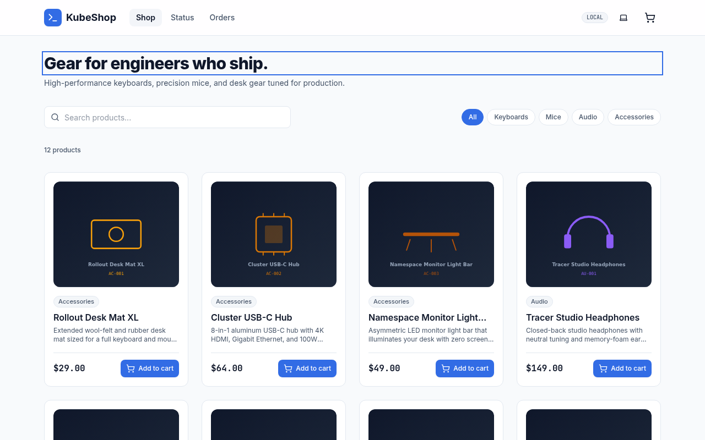
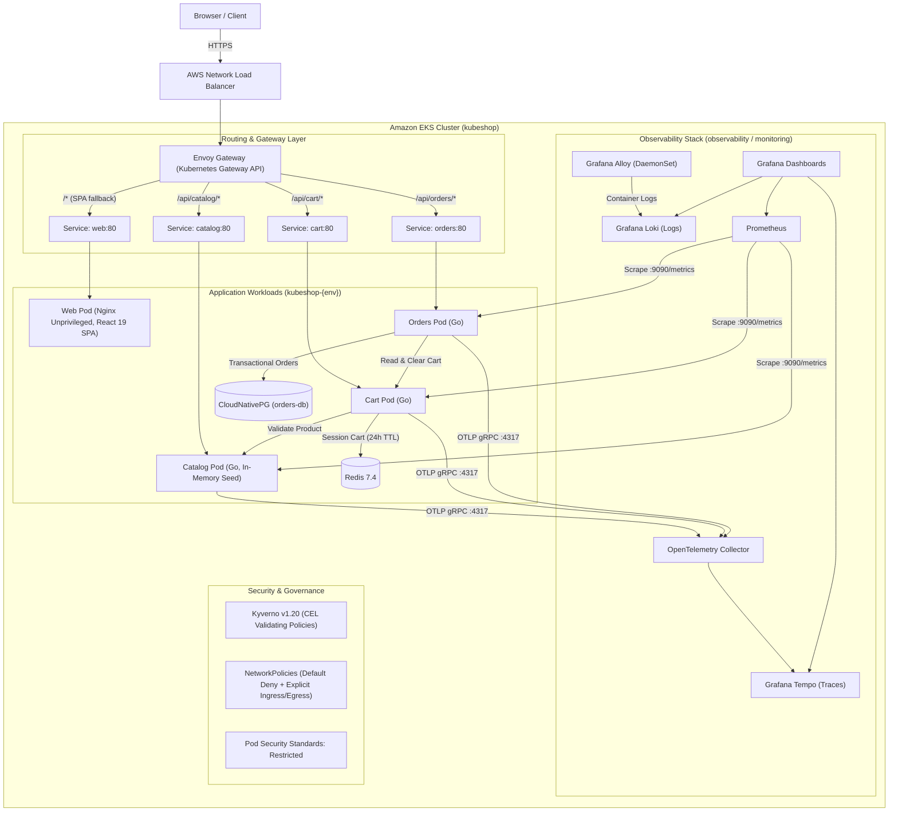

# KubeShop

> **Gear for engineers** — A cloud-native microservices e-commerce platform and platform engineering showcase built with Go, React 19, PostgreSQL, Redis, Terraform EKS, Argo CD, and Argo Rollouts.

[](https://github.com/omar-riadd/KubeShop/actions/workflows/ci-services.yml)
[](https://github.com/omar-riadd/KubeShop/actions/workflows/ci-web.yml)
[](https://github.com/omar-riadd/KubeShop/actions/workflows/security.yml)
[](https://github.com/omar-riadd/KubeShop/actions/workflows/helm-gitops.yml)
[](https://github.com/omar-riadd/KubeShop/actions/workflows/terraform.yml)

[Quickstart (Clone to Destroy)](#1-quickstart-clone-to-destroy) · [AWS EKS Deploy & Teardown](#2-aws-eks-deployment--teardown) · [Architecture](#3-architecture) · [Core Components](#4-core-components) · [Testing & Linters](#5-testing--linters) · [Runbooks](#7-documentation--runbooks)

| Storefront (Light) | Storefront (Dark) | Platform Status & Rollout Monitor |
|---|---|---|
|  |  |  |

---

## 1. Quickstart: Clone to Destroy

Run the full platform locally in a couple of minutes — **only Docker (v24+ with Compose v2) is required**. You do not need Go, Node.js, PostgreSQL, or Redis installed on your machine.

### Step 1 — Clone the repository
```bash
git clone https://github.com/omar-riadd/KubeShop.git
cd KubeShop
```

### Step 2 — Start the full stack
```bash
make up
```
*(Without `make`: `docker compose --profile full up -d --build`)*

If port `8080` is already in use on your machine, override the gateway port:
```bash
GATEWAY_PORT=8090 make up
```

**What starts automatically:**
1. **PostgreSQL 17** (`postgres`) and **Redis 7** (`redis`) with health checks.
2. **Database migrations** (`orders-migrate`) creating the orders schema and indexes.
3. **Go microservices**: `catalog` (`:8081`), `cart` (`:8082`), and `orders` (`:8083`).
4. **React 19 storefront** (`web`) served by hardened unprivileged Nginx.
5. **Reverse-proxy gateway** (`gateway`) exposing the entire app on `http://localhost:8080`.

### Step 3 — Use the app
Open [`http://localhost:8080`](http://localhost:8080) in your browser:

| What | URL | Try This |
|---|---|---|
| **Storefront** | [`http://localhost:8080`](http://localhost:8080) | Browse products, press `Cmd+K` / `Ctrl+K` to search, open the Cart Drawer, and complete a checkout. |
| **Rollout & Health Monitor** | [`http://localhost:8080/status`](http://localhost:8080/status) | View live service health, latency, pod identity, and run a synthetic traffic probe. |
| **Catalog API** | [`http://localhost:8080/api/catalog/products`](http://localhost:8080/api/catalog/products) | Returns the 12 seeded engineering gear products. |
| **Service Versions** | [`/api/catalog/version`](http://localhost:8080/api/catalog/version) · [`/api/cart/version`](http://localhost:8080/api/cart/version) · [`/api/orders/version`](http://localhost:8080/api/orders/version) | Build metadata and pod identity for each Go service. |

Watch live logs from all containers at any time:
```bash
make logs
```

### Step 4 — Verify with a quick smoke test (optional)
```bash
# Quick API check
curl -fsS http://localhost:8080/api/catalog/products | grep -q "Keyboard" && echo "OK"

# Full k6 smoke test (28 checks across catalog, cart, checkout, idempotency)
make load-test
# Or with a custom port: BASE_URL=http://localhost:8090 k6 run tests/load/smoke.js
```

### Step 5 — Stop and destroy everything locally
```bash
make down
```
*(Without `make`: `docker compose --profile full --profile backend down -v --remove-orphans`)*

This stops and removes all containers, Docker networks, and local PostgreSQL/Redis volumes (`-v`), leaving nothing behind.

---

## 2. AWS EKS Deployment & Teardown

> [!WARNING]
> Provisioning on AWS creates billable resources (EKS control plane, EC2 nodes, NAT Gateway, EBS volumes, NLB). Always run teardown when finished.

### Deploy
1. **Substitute placeholders** (copy `.env.bootstrap.example` → `.env.bootstrap`, fill in your values):
   ```bash
   cp .env.bootstrap.example .env.bootstrap
   # edit .env.bootstrap with GH_OWNER, GH_REPO, BASE_DOMAIN, AWS_ACCOUNT_ID, AWS_REGION, CLUSTER_NAME, HOSTED_ZONE_ID
   make bootstrap
   make check-placeholders
   ```
2. **Create Terraform remote state bucket** (one-time per AWS account):
   ```bash
   terraform -chdir=infra/terraform/bootstrap init
   terraform -chdir=infra/terraform/bootstrap apply \
     -var="state_bucket_name=kubeshop-tfstate-<AWS_ACCOUNT_ID>"
   ```
3. **Provision EKS cluster & Argo CD**:
   ```bash
   cp infra/terraform/envs/main/terraform.tfvars.example infra/terraform/envs/main/terraform.tfvars
   # edit terraform.tfvars with your values
   export TF_VAR_slack_webhook_url="<SLACK_WEBHOOK_URL>"

   terraform -chdir=infra/terraform/envs/main init \
     -backend-config="bucket=kubeshop-tfstate-<AWS_ACCOUNT_ID>" \
     -backend-config="region=eu-central-1"
   terraform -chdir=infra/terraform/envs/main apply
   ```
4. **Connect `kubectl` & watch Argo CD sync**:
   ```bash
   aws eks update-kubeconfig --region eu-central-1 --name kubeshop
   kubectl -n argocd get applications
   ```

### Destroy (exact order — run as your normal user, never with `sudo`)
```bash
# 1. Remove Argo CD apps, AWS Network Load Balancers, and StatefulSet EBS PVCs cleanly
make cluster-down

# 2. Destroy the EKS cluster, node groups, Secrets Manager secrets, NAT Gateway, and VPC
terraform -chdir=infra/terraform/envs/main destroy

# 3. Optional: destroy the S3 remote state bucket when permanently retiring the project
terraform -chdir=infra/terraform/bootstrap destroy
```

For full cloud setup and verification details, see [docs/runbooks/bootstrap.md](docs/runbooks/bootstrap.md) and [docs/runbooks/teardown.md](docs/runbooks/teardown.md).

---

## 3. Architecture



---

## 4. Core Components

- **Go 1.24 Microservices (`services/`)**:
  - `catalog`: In-memory product catalog (search, category filter, pagination).
  - `cart`: Anonymous session cart in Redis (24h TTL) with retry/backoff to `catalog`.
  - `orders`: ACID PostgreSQL checkout with idempotency keys, bounded `pgxpool` (`MaxConns=25`), per-session rate limiting (`X-Real-IP` / `RemoteAddr`), and constant-time admin Bearer auth on `PATCH /api/orders/{id}/status`.
  - `internal/platform`: Shared `slog` JSON logging, OTel tracing, Prometheus RED metrics, 16 KiB body limits, graceful shutdown, and fault injection.
- **React 19 SPA (`web/`)**:
  - Vite, TypeScript, Tailwind CSS v4, TanStack Query v5, lazy-loaded routes, MSW offline dev mode (`pnpm --dir web dev`).
  - `Cmd+K` Command Palette, slide-out Cart Drawer, Sticky Quick-Buy, spec comparison modal, bundle offers, and `/status` canary monitor.
  - `sessionStorage` + 24h TTL sessions, `crypto.getRandomValues` UUID fallback, unprivileged read-only Nginx, strict CSP, and WCAG 2.1 AA compliance.
- **Terraform & GitOps (`infra/terraform/`, `deploy/`, `gitops/`)**:
  - Modular AWS Terraform (`network`, `eks`, `iam-irsa`, `secrets`, `github-oidc`, `budget`) with native S3 lockfiles (`use_lockfile = true`).
  - Shared Helm app chart (`deploy/charts/app`), per-env baseline chart (`deploy/charts/env-baseline`), External Secrets Operator (`external-secrets.io/v1` syncing `cart-redis` & `orders-admin`), encrypted `gp3` `StorageClass` (`Wave -3`), and `RollingSync` platform waves (Wave 0: `envoy-gateway`, `external-secrets`, `kyverno`, `argo-rollouts`, `cloudnative-pg`, `keda`, `kube-prometheus-stack`; Wave 1: `cert-manager`, `external-dns`, `loki`, `tempo`, `alloy`, `otel-collector`, `opencost`; Wave 2: cluster manifests).
- **Security & Observability**:
  - 7 Kyverno native CEL admission policies, Cosign keyless signing, CycloneDX SBOM attestations, Trivy/Gitleaks/golangci-lint/ESLint gates, 28-day multi-burn-rate SLO alerts, and 5 Grafana dashboards as code.

---

## 5. Testing & Linters

```bash
# Backend unit, integration (testcontainers), contract & race tests (>84% coverage)
make test
make lint

# OpenAPI 3.1 contract lint
make openapi-lint

# Frontend lint, format check, unit tests (55/55 Vitest), and production build
pnpm --dir web lint
pnpm --dir web format:check
pnpm --dir web test --run
pnpm --dir web build

# Playwright E2E + WCAG 2.1 AA audits (requires `make up`)
BASE_URL=http://localhost:8080 pnpm --dir web test:e2e

# Shell, Kyverno, Terraform & secret checks
shellcheck scripts/cluster-down.sh
kyverno test gitops/platform/kyverno/tests
terraform fmt -check -recursive infra/terraform
gitleaks detect --source . -v
```

<details>
<summary><b>Alternative local dev modes (Backend-only or Frontend-only with MSW mocks)</b></summary>

```bash
# Backend services + Postgres + Redis only
make dev-backend
make down

# Frontend UI only (in-browser MSW mocks, no Docker required)
pnpm --dir web install
pnpm --dir web dev   # opens http://localhost:5173
```
</details>

---

## 6. Repository Structure

```
KubeShop/
├── .github/workflows/             # CI/CD (Go, Web, Security, Helm/GitOps, Terraform, Promotion)
├── api/                           # OpenAPI 3.1 contract (openapi.yaml) & Redocly config
├── deploy/
│   ├── charts/app/                # Shared workload Helm chart (Rollouts, HTTPRoutes, NetPols)
│   ├── charts/env-baseline/       # Namespace quotas, Redis, CloudNativePG, ExternalSecrets
│   └── compose/gateway.nginx.conf # Local Nginx gateway mirroring Envoy Gateway routes
├── docs/
│   ├── runbooks/                  # repo-setup, bootstrap, promotion, rollback, incident-response, teardown
│   ├── ui/screenshots/            # Storefront & status monitor screenshots
│   ├── architecture.md            # Deep-dive system & telemetry diagrams
│   └── PLACEHOLDERS.md            # Environment placeholder reference
├── gitops/                        # Argo CD bootstrap, platform RollingSync, and dev/staging/prod apps
├── infra/terraform/               # S3 state bootstrap, 6 AWS modules, and EKS main stack
├── scripts/
│   ├── bootstrap-placeholders.sh  # Automated placeholder substitution (--dry-run, --check)
│   └── cluster-down.sh            # Ordered Argo CD, LoadBalancer, and PVC teardown helper
├── services/                      # Go microservices monorepo (catalog, cart, orders, internal/platform)
├── tests/load/                    # k6 load scripts (smoke, load, stress)
├── web/                           # React 19 SPA + Vitest + Playwright E2E suite
├── docker-compose.yml             # Local full-stack development environment
└── Makefile                       # Common tasks (up, down, dev-backend, test, lint, bootstrap, cluster-down)
```

---

## 7. Documentation & Runbooks

- **Architecture & Setup**: [System Architecture](docs/architecture.md) · [Placeholder Registry](docs/PLACEHOLDERS.md) · [Terraform Guide](infra/terraform/README.md)
- **Operational Runbooks**: [Repository Setup](docs/runbooks/repo-setup.md) · [Cluster Bootstrap](docs/runbooks/bootstrap.md) · [GitOps Promotion](docs/runbooks/promotion.md) · [Rollback](docs/runbooks/rollback.md) · [Incident Response](docs/runbooks/incident-response.md) · [Cluster Teardown](docs/runbooks/teardown.md)

| Environment | Namespace | URL | Deployment Method |
|---|---|---|---|
| **Local** | N/A | `http://localhost:8080` | Docker Compose (`make up`) |
| **Dev** | `kubeshop-dev` | `https://dev.<BASE_DOMAIN>` | Auto-deployed from `main` via GitOps PR |
| **Staging** | `kubeshop-staging` | `https://staging.<BASE_DOMAIN>` | Promoted via `promote.yml` workflow PR |
| **Prod** | `kubeshop-prod` | `https://app.<BASE_DOMAIN>` | Promoted via `promote.yml` PR (`CODEOWNERS` approval) |

---

## 8. License & Ownership

Maintained by **Omar Riadd** ([@omar-riadd](https://github.com/omar-riadd)).  
Repository: [`https://github.com/omar-riadd/KubeShop.git`](https://github.com/omar-riadd/KubeShop.git)
