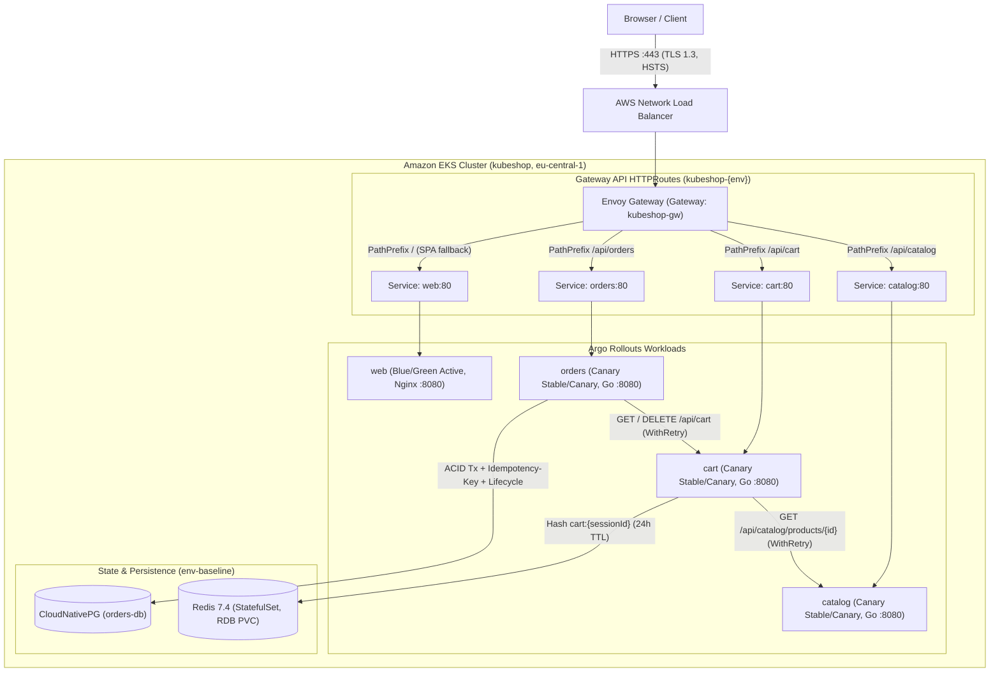
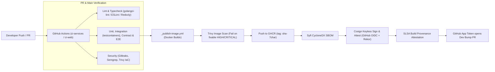
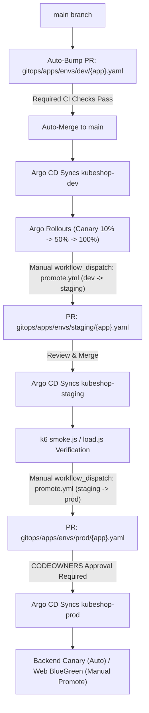
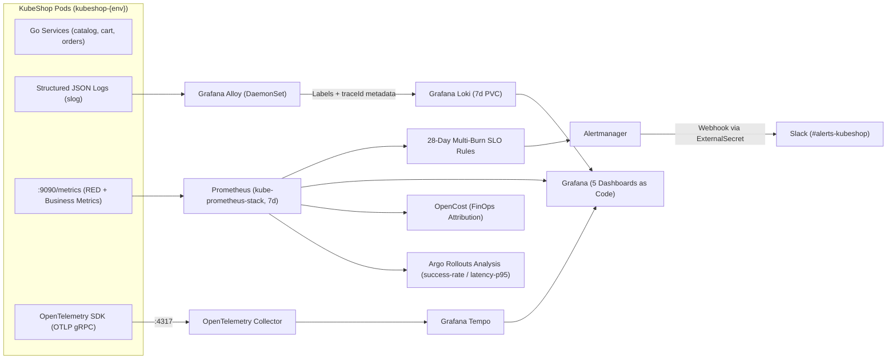
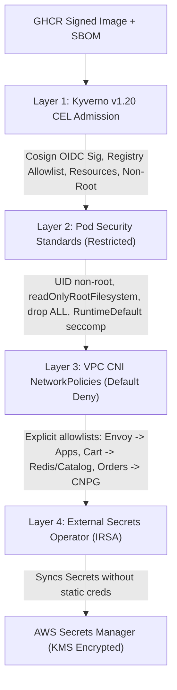

# KubeShop System Architecture (`docs/architecture.md`)

This document provides the end-to-end architectural blueprint for **KubeShop** ("Gear for engineers"), covering runtime topology, CI/CD supply-chain security, GitOps promotion, observability & SLO telemetry, and Kubernetes security boundaries.

For architectural trade-offs and decision rationale, see the [Architecture Decision Records (ADRs)](adr/README.md).

---

## 1. Runtime Topology & Traffic Routing

All traffic enters a single internet-facing AWS Network Load Balancer managed by the AWS Load Balancer Controller and routed by **Envoy Gateway** (Kubernetes Gateway API). Same-origin routing eliminates CORS complexity: the browser communicates solely with `https://<env>.<BASE_DOMAIN>` using relative `/api/*` paths with zero path rewriting.

### Key Runtime Guarantees
- **No Path Rewriting**: Every backend serves its own prefix (`/api/catalog`, `/api/cart`, `/api/orders`), matching local Compose and Kubernetes routing identically.
- **Admin Port Isolation**: Backend admin endpoints (`:9090/healthz`, `:9090/readyz`, `:9090/metrics`) are never exposed on Gateway `HTTPRoute` objects.
- **Defense-in-Depth Rate Limiting**: Gateway-level `BackendTrafficPolicy` enforces `30 req/s` per client IP on `/api/*`, paired with an in-process per-session token-bucket limiter (`rps=2, burst=5`) on `POST /api/orders` returning `429 RATE_LIMIT_EXCEEDED`.
- **Resilient Upstream Communication**: Service-to-service HTTP requests (`cart` → `catalog`, `orders` → `cart`) employ exponential backoff with jitter (`100ms`–`5s`, 3 attempts) for transient 5xx/network errors while fast-failing client errors.
- **Node Isolation**: `dev`, `staging`, and platform addons schedule on EC2 Spot nodes; `prod` workloads schedule exclusively on `ondemand` nodes via `nodeSelector: workload=prod` and matching taint toleration.

---

## 2. CI/CD & Software Supply Chain Flow

Every container image built from `main` is scanned, cataloged with a CycloneDX SBOM, signed keyless via Sigstore Cosign using GitHub Actions OIDC, and attested with SLSA build provenance before being deployed.

### Supply-Chain Controls
- **Pinned Actions & Base Images**: All GitHub Actions are pinned to full commit SHAs; base images use distroless/unprivileged digests maintained by Renovate.
- **Keyless Signing**: Zero long-lived signing keys; Cosign binds signatures to the GitHub Actions OIDC identity (`refs/heads/main`).
- **Bot PR Auth**: Uses a GitHub App installation token (`actions/create-github-app-token`) so automated PRs trigger required status checks and respect branch protection.

---

## 3. GitOps & Environment Promotion Flow

KubeShop uses **Argo CD** with an App-of-Apps root bootstrap (`gitops/bootstrap/`) and matrix `ApplicationSet`s. No human or CI job executes `kubectl apply` against the cluster.

### Sync Waves (`gitops/bootstrap/bootstrap.yaml` & `gitops/platform/applicationset.yaml`)
- **Bootstrap (`Wave -3`)**: Encrypted `gp3` `StorageClass` (`ebs.csi.aws.com`, cluster default).
- **Wave 0 (CRDs, Gateway API & Core Operators)**: `envoy-gateway` (installs Gateway API CRDs), `external-secrets`, `kyverno`, `argo-rollouts`, `cloudnative-pg`, `keda`, `kube-prometheus-stack`.
- **Wave 1 (TLS, DNS & Telemetry)**: `cert-manager`, `external-dns`, `loki`, `tempo`, `alloy`, `otel-collector`, `opencost`.
- **Wave 2 (Cluster Manifests)**: `ClusterIssuer`, `GatewayClass` + `EnvoyProxy`, `Gateway`, `ClusterSecretStore`, Kyverno CEL policies, PrometheusRules, Grafana dashboards, `ClusterAnalysisTemplate`s.

---

## 4. Observability & SLO Pipeline

All three signals — Metrics, Logs, and Traces — are correlated via `requestId` and W3C `traceparent` / `traceId` for rapid root-cause isolation.

### 28-Day Service Level Objectives (SLOs)
| Service | SLI | Objective |
|---|---|---|
| `catalog`, `cart` | Availability (non-5xx / all requests, excluding `/version`) | **99.5%** |
| `orders` | Availability (non-5xx / all `POST /api/orders`) | **99.5%** |
| `catalog` | Latency (`GET /api/catalog/products` < 300 ms) | **95.0%** |
| `orders` | Latency (`POST /api/orders` < 800 ms) | **95.0%** |

Multi-window multi-burn-rate alerts fire at **14.4x** burn (1h/5m critical) and **6x** burn (6h/30m warning).

---

## 5. Security & Policy Defense-in-Depth

Security is enforced across four independent layers: admission policy, runtime pod hardening, network micro-segmentation, and secret management.

### Defense-in-Depth Summary
- **Admission Control**: 7 Kyverno v1.20 native CEL policies verified in CI via `kyverno test` (10/10 passing).
- **Zero-Trust Networking**: Every `kubeshop-*` namespace applies default-deny ingress and egress policies with explicit port/pod selectors (including CloudNativePG replication and Kubernetes API rules).
- **Strict Browser CSP**: `web` Nginx serves `script-src 'self'; style-src 'self'; frame-ancestors 'none'` with zero inline scripts or external CDNs.
- **No Static AWS Keys**: Terraform CI uses GitHub OIDC (`kubeshop-terraform-plan` / `kubeshop-terraform-apply`); cluster controllers use EKS IRSA.
